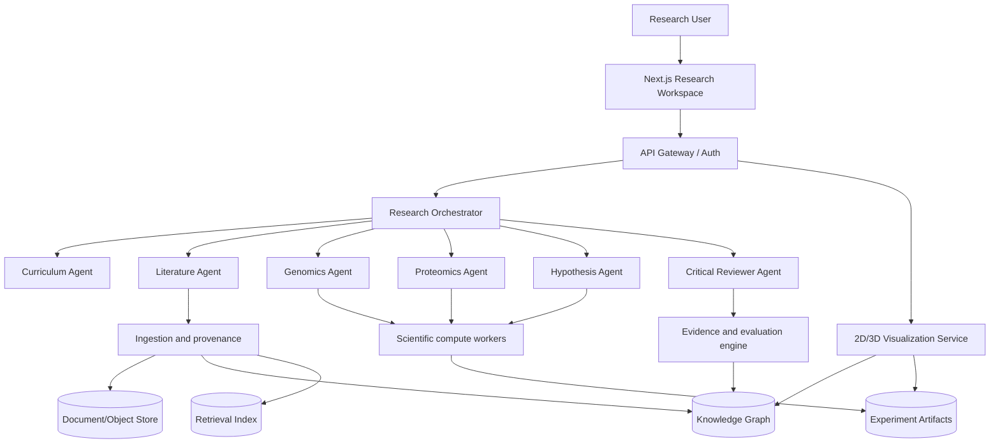
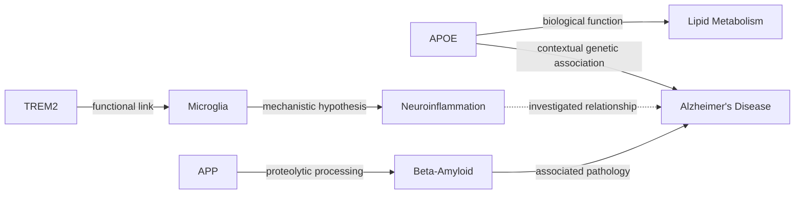

# NeuroGenesis AI
## Autonomous and Assisted Research Platform for Alzheimer's Disease

**Version:** 0.1 — research and development specification  
**Date:** October 2026  
**Status:** technical proposal; does not constitute evidence of medical efficacy or validated discovery  
**Vision:** transform scientific literature, multi-omic data, and computational models into an interactive environment capable of formulating, testing, and prioritizing investigable hypotheses on Alzheimer's disease.

---

## 1. Executive Summary

NeuroGenesis AI is a biomedical research platform combining AI agents, scientific search, bioinformatic analysis, knowledge graphs, 3D molecular visualization, statistical models, and a hypothesis generation engine. Its first specialization is Alzheimer's disease (AD). The system begins with a progressive documentary training phase—basic, intermediate, advanced, and scientific—maintaining a versioned, provenance-backed knowledge base. It then identifies open questions, retrieves and reads publications, integrates genetic, transcriptomic, proteomic, and pharmacological data, constructs *hypothetical* causal graphs, and proposes computational experiments.

**Realistic promise:** accelerate evidence synthesis and hypothesis prioritization for researchers. **Does not promise** to discover a cure, replace physical experiments, perform diagnostics, or recommend individual treatments.

### 1.1 Objectives
1. Build a digital researcher that masters the domain through source retrieval, structuring, and evaluation—not through unverified claims of weight self-training.
2. Maintain a scientific library with provenance, licensing, timestamps, and versioning.
3. Generate maps of genes, variants, proteins, pathways, cell types, compounds, phenotypes, and studies.
4. Enable visual 2D/3D exploration of DNA, genomic variants, protein structures, and biological networks.
5. Support natural language querying with claim-level citations and drill-down navigation to primary evidence.
6. Formulate novel, falsifiable hypotheses, search for contradictory evidence, and benchmark them against baselines.
7. Produce reproducible reports, notebooks, tables, figures, and research bundles.
8. Prepare collaborative handoffs with wet labs and domain scientists for subsequent experimental validation.

### 1.2 Target Users
Neurodegeneration researchers, bioinformaticians, molecular biologists, pharmacologists, graduate students, and drug discovery teams. A separate educational mode serves the general public; no automated clinical decisions.

### 1.3 Core Principles
**Evidence-first; human-in-the-loop; reproducibility; data security; explicit uncertainty; provenance explainability; falsifiability; interoperability; clear distinctions between association and causality.**

---

## 2. Scientific Foundations of Alzheimer's Disease

### 2.1 Definition and Heterogeneity
Alzheimer's disease is a heterogeneous neurodegenerative disorder characterized by progressive cognitive decline and neuropathological processes that can precede overt symptoms by decades. Pathology involves amyloid-beta and tau alterations, but equally encompasses synaptic dysfunction, neuroinflammation, metabolic collapse, vascular impairment, and complex polygenic and environmental risk factors. Correlation does not imply a causal mechanism.

### 2.2 Priority Research Areas
- **Amyloid:** APP processing, secretase kinetics, Aβ peptide species, oligomerization, aggregation, and clearance cascades.
- **Tau:** MAPT biology, post-translational modifications (hyperphosphorylation, acetylation), pathological aggregation, and trans-synaptic spreading.
- **Genetics:** APOE, APP, PSEN1, PSEN2, TREM2, ABCA7, BIN1, CLU, PICALM, and emerging risk loci evaluated within genomic context.
- **Neuroimmunity:** Microglia, astrocytes, TREM2 signaling axes, and neuroinflammatory cascades.
- **Endosomal/Lysosomal System and Autophagy:** Proteostasis, endocytic trafficking, and lysosomal clearance failure.
- **Synapses and Circuits:** Synaptic plasticity, network connectivity breakdown, and neurodegeneration.
- **Metabolism and Mitochondria:** Oxidative stress, bioenergetics, and lipid dysregulation.
- **Neurovascular Unit:** Blood-brain barrier (BBB) integrity, cerebral amyloid angiopathy (CAA), and perfusion deficits.
- **Biomarkers:** Fluid (CSF, plasma p-tau, Aβ42/40 ratio, NfL) and imaging (amyloid PET, tau PET, volumetric MRI) biomarkers governed by updated diagnostic and research frameworks.
- **Pharmacology:** Mechanisms of action, clinical trial endpoints, adverse effects (e.g., ARIA), and translational barriers.

### 2.3 Ontologies and Controlled Vocabularies
Stable, version-pinned identifiers and cross-references: HGNC/Ensembl/NCBI Gene (genes), dbSNP/ClinVar (variants), UniProt (proteins), Gene Ontology (molecular functions, biological processes, cellular components), Reactome (pathways), MONDO/MeSH (diseases), ChEBI/ChEMBL/PubChem (small molecules and compounds), Cell Ontology (cell types), HPO (phenotypes), ORCID/ROR (authors and institutions). Identifiers must retain organism, genome assembly reference (e.g., GRCh38), and experimental context.

---

## 3. Researcher Experience

### 3.1 Agent Onboarding Workflow
The researcher initiates a project (`Alzheimer / General` or a targeted inquiry). The agent initiates a 4-level progressive curriculum, logging reviewed sources, assessed comprehension scores, and detected knowledge gaps.

| Level | Objective | Source Material | Deliverable | Milestone Validation |
|---|---|---|---|---|
| 1. Basic | Terminology, pathophysiology, symptoms, and core concepts | Authoritative reviews and institutional sources | Glossary and introductory conceptual map | Reference-backed Q&A |
| 2. Intermediate | Genes, proteins, biomarkers, and biochemical pathways | Thematic reviews and landmark primary studies | Mechanistic wiring diagram | Cross-reference validation |
| 3. Advanced | Multi-omics, biostatistics, disease models, and scientific controversies | Methodologies, open datasets, and critical meta-analyses | Evidence matrix and contradiction ledger | Methodological critique |
| 4. Scientific | Primary literature synthesis, replication, and experimental design | Primary research articles, supplements, and raw data | Reproducible scientific research dossier | Replication of select published results |

**Crucial distinction:** "Documenting" denotes indexing, structuring, and reasoning over external sources, establishing persistent external memory, and passing objective evaluation benchmarks; it does not imply that an LLM has modified its model weights or acquired clinical competence.

### 3.2 Core Interface Modules
- **Research Workspace:** Projects, objectives, tasks, and synthesized findings.
- **Scientific Chat:** Claim-level cited dialogue, direct links to figures and datasets, and built-in "find contradictory evidence" queries.
- **Paper Explorer:** Semantic search, faceted filtering, critical summaries, section-by-section reader, extracted methodology/limitations tables.
- **Knowledge Graph:** Interactive network of biological entities and relationships, filtered by evidence grade, tissue, organism, publication date, and source.
- **Genome Browser:** Chromosomal coordinates, variant tracks, and annotations; **illustrative** 3D double-helix rendering when atomic coordinates are absent.
- **Molecular 3D Lab:** Macromolecules and ligands using experimental PDB / AlphaFold structures, with provenance and confidence scores (pLDDT).
- **Hypothesis Studio:** Hypotheses, supporting/counter-evidence matrices, testable predictions, experimental protocols, and verification statuses.
- **Experiment Console:** Jupyter notebooks, execution jobs, parameters, outputs, execution logs, and reproducibility bundles.
- **Evidence Ledger:** Append-only cryptographic audit trail for every claim, artifact, and data transformation.

### 3.3 Example Interactions
- "Explain APOE4 first at an introductory level, then at a structural molecular level."
- "Find studies linking TREM2 to microglial activation, separating human clinical evidence from animal models."
- "Show an APOE–lipid metabolism–microglia subgraph, filtering for relationships supported by more than one independent study."
- "Visualize the APP genomic locus on GRCh38 assembly with all annotated pathogenic variants."
- "Load the experimental 3D structure of an Alzheimer-related protein and highlight known functional binding pockets."
- "Propose three falsifiable mechanistic hypotheses, including alternative confounding explanations and a computational validation plan."
- "What published studies contradict this hypothesis?"
- "Generate a reproducible research report containing data sources, methodology, stated uncertainties, and recommended next experiments."

---

## 4. System Architecture



### 4.1 Recommended Technology Stack
| Layer | Selection | Justification |
|---|---|---|
| Frontend | Next.js + TypeScript | High-performance interactive workspace and UI components |
| Graph Visualization | Cytoscape.js / Sigma.js | Large-scale network navigation, clustering, and filtering |
| 3D Molecular Graphics | Mol* / 3Dmol.js | Native PDB/mmCIF rendering, surfaces, electron density, and annotations |
| Genome Browser | IGV.js / JBrowse 2 | Coordinate tracks, genomic variants, and alignments |
| General 3D Visualization | Three.js | Educational scenes and schematic animations with explicit provenance labels |
| API Layer | FastAPI + Pydantic | Strongly-typed, asynchronous scientific web services |
| Scientific Computing | Python, PyTorch, pandas, NumPy, SciPy, scikit-learn | Core bioinformatics, statistical modeling, and ML |
| Bioinformatics | Biopython, pysam, Scanpy, anndata, gseapy | Sequence analysis, single-cell transcriptomics, and pathway enrichment |
| Cheminformatics | RDKit | Chemical descriptors, molecular fingerprints, and ligand handling |
| Task Orchestration | Temporal or Celery | Long-running asynchronous workflows, retries, and auditability |
| High-Performance Services | Rust (optional, post-profiling) | High-throughput parsing, streaming, and compute bottlenecks |
| Relational Database | PostgreSQL | Relational entities, research runs, user permissions, and metadata |
| Graph Database | Neo4j or PostgreSQL + age/ltree | Structured relationships and traversal queries |
| Vector / Retrieval | PostgreSQL pgvector / hybrid search | Hybrid dense/sparse semantic retrieval and RAG |
| Object Storage | S3 / MinIO | Licensed papers, structures, raw datasets, and generated artifacts |
| Observability | OpenTelemetry + Prometheus/Grafana | Distributed tracing, metrics, and agent audit trails |
| Reproducibility | Docker, pinned lockfiles, DVC/MLflow | Code, data, and model lineage versioning |

**Design Rule:** Begin as a modular monolith with dedicated background workers; extract microservices only when traffic patterns and team distribution justify it.

### 4.2 Repository Structure
```text
neurogenesis/
  apps/
    web/                      # Next.js workspace
    api/                      # FastAPI gateway
  packages/
    contracts/                # OpenAPI, JSON Schema, shared types
    scientific-core/          # Normalization, statistics, graph algorithms
    agents/                   # Agent definitions and execution policies
    connectors/               # PubMed, Europe PMC, GDC, ClinVar, UniProt
    hypotheses/               # Generation and scoring engine
    visualization/            # 3D adapters and genome browser wrappers
  workers/
    ingestion/
    bioinformatics/
    molecular/
    evaluation/
  data/
    schemas/
    ontologies/
    fixtures/                 # Synthetic and redistributable test data
  experiments/
    NL-AD-001/
    NL-AD-002/
  infrastructure/
    compose.yaml
    terraform/
  docs/
    architecture/
    adr/
    research/
    safety/
  tests/
    unit/
    integration/
    scientific/
    security/
```

---

## 5. Scientific Agents and Orchestration

### 5.1 Specialized Agents
1. **Curriculum Agent:** Selects level-appropriate literature, constructs conceptual maps, and generates comprehension assessments.
2. **Literature Scout:** Queries publications, preprints, and reviews; deduplicates across DOI/PMID; tracks retractions and errata.
3. **Paper Analyst:** Extracts research questions, cohorts, methods, metrics, findings, limitations, and grounded claims.
4. **Genomics Agent:** Associates variants, genes, loci, functional annotations, and genome build coordinates.
5. **Transcriptomics Agent:** Analyzes differential expression, cell-type specific signatures, and gene set enrichment.
6. **Proteomics Agent:** Integrates protein-protein interactions and post-translational modifications; distinguishes predicted from experimental structures.
7. **Pathway Agent:** Maps biological processes and pathway cross-talk dependencies.
8. **Pharmacology Agent:** Queries chemical compounds, binding affinities, mechanisms of action, and clinical trial results; strictly disclaims clinical prescriptions.
9. **Graph Curator:** Resolves biological entities and aggregates evidence-backed relations with full provenance.
10. **Hypothesis Generator:** Formulates novel, testable, and falsifiable relational mechanisms and predictions.
11. **Adversarial Reviewer:** Actively searches for counter-evidence, confounding factors, selection biases, and rival mechanistic explanations.
12. **Experiment Designer:** Proposes computational verification pipelines and data prerequisite specifications.
13. **Reproducibility Auditor:** Audits code environments, seeds, data snapshots, execution logs, and data leakage risks.
14. **Scientific Report Writer:** Compiles publication-grade dossiers separating empirical facts, model inferences, and speculative hypotheses.

### 5.2 Autonomous Cycle with Human-in-the-Loop Gates


Automated literature searches on public APIs run autonomously within configured rate limits. Gated actions—requiring explicit human-in-the-loop approval—include restricted dataset downloads, personal/clinical data ingestion, compute spend thresholds, execution of generated sandbox code, and physical wet-lab collaboration handoffs.

### 5.3 Agent Contract Specification
```json
{
  "agent_id": "paper-analyst",
  "version": "0.1.0",
  "capabilities": ["extract_study_design", "extract_claims", "identify_limitations"],
  "allowed_tools": ["literature.search", "literature.fetch_metadata", "papers.read_authorized"],
  "requires_human_approval": ["external_data_export"],
  "output_schema": "StudyEvidenceRecord/v1",
  "max_cost_usd_per_task": 2.0,
  "audit_required": true
}
```

---

## 6. Data Sources and Ingestion

### 6.1 Initial Catalog
| Source | Domain / Usage | URL |
|---|---|---|
| PubMed / NCBI E-utilities | Biomedical search and metadata | https://www.ncbi.nlm.nih.gov/books/NBK25501/ |
| Europe PMC | Open access full texts and metadata | https://www.ebi.ac.uk/europepmc/ |
| OpenAlex | Bibliographic knowledge graph and citation networks | https://docs.openalex.org/ |
| Crossref | DOI resolution, metadata, and retraction notices | https://www.crossref.org/documentation/retrieve-metadata/rest-api/ |
| AD Knowledge Portal | Alzheimer's disease multi-omics (access-controlled) | https://adknowledgeportal.org/ |
| Agora | Curated evidence for Alzheimer's therapeutic targets | https://agora.adknowledgeportal.org/ |
| ADNI | Neuroimaging and fluid biomarkers (DUA required) | https://adni.loni.usc.edu/ |
| NCBI Gene / Ensembl | Genomic coordinates, genes, and transcripts | https://www.ensembl.org/ |
| ClinVar | Genomic variant interpretations and clinical evidence | https://www.ncbi.nlm.nih.gov/clinvar/ |
| UniProt | Protein sequences, functional domains, and annotations | https://www.uniprot.org/ |
| RCSB PDB | Experimentally determined macromolecular structures | https://www.rcsb.org/ |
| AlphaFold DB | Computationally predicted protein structures and pLDDT scores | https://alphafold.ebi.ac.uk/ |
| Reactome | Curated biological pathways and reactions | https://reactome.org/ |
| STRING | Protein-protein functional associations (not necessarily physical interactions) | https://string-db.org/ |
| ChEMBL | Bioactive drug-like small molecules and targets | https://www.ebi.ac.uk/chembl/ |
| PubChem | Chemical structures, bioassays, and properties | https://pubchem.ncbi.nlm.nih.gov/ |
| ClinicalTrials.gov | Registered clinical trials, protocols, and outcomes | https://clinicaltrials.gov/data-api/api |

All APIs, licensing terms, rate limits, and schemas must be validated before implementing connectors; inclusion in this catalog does not imply unrestricted public access.

### 6.2 Literature Ingestion Pipeline
1. Construct reproducible search queries with MeSH terms, controlled synonyms, date boundaries, and publication filters.
2. Retrieve metadata, persistently recording query parameters, timestamp, API provider, and licensing status.
3. Deduplicate records across DOI and PMID, indexing preprint vs. peer-reviewed journal versions.
4. Query Crossref/Retraction Watch endpoints to identify retractions, errata, or expressions of concern.
5. Ingest full-text content only when licensing permits; fall back to abstract and metadata otherwise.
6. Extract sections, tables, and references, preserving exact character offsets, page coordinates, and source text snippets.
7. Deconstruct findings into atomic claims and link each claim to its exact verbatim source fragment.
8. Index text using hybrid sparse (BM25) and dense vector embeddings; isolate proprietary/sensitive data.
9. Validate extractions via automated rule checking and expert human sampling.

### 6.3 Evidence Claim Schema
```json
{
  "claim_id": "claim:uuid",
  "statement": "Observed association between X and Y in biological context Z",
  "source": {"doi": "10.example/placeholder", "pmid": null, "section": "Results", "locator": "paragraph:12"},
  "study": {"type": "observational", "species": "human", "tissue": "brain", "sample_size": null},
  "effect": {"metric": null, "value": null, "confidence_interval": null},
  "interpretation": "association_not_causation",
  "extraction_method": "llm_plus_rules",
  "review_status": "unreviewed",
  "source_access": "metadata_only"
}
```

Fabricated DOIs, synthetic results, fictional sample sizes, and hallucinated confidence intervals are strictly prohibited. Records marked `placeholder` represent synthetic test fixtures.

---

## 7. Biomedical Knowledge Graph and Structured Evidence

### 7.1 Entity Node Types
`Disease`, `Gene`, `Variant`, `Protein`, `Pathway`, `CellType`, `Tissue`, `Compound`, `Phenotype`, `Biomarker`, `Study`, `Dataset`, `Hypothesis`, `Experiment`, `EvidenceClaim`, `Researcher`.

### 7.2 Edge Types
`ASSOCIATED_WITH`, `ENCODES`, `PARTICIPATES_IN`, `EXPRESSED_IN`, `INTERACTS_WITH`, `PERTURBS`, `TARGETS`, `MEASURED_IN`, `SUPPORTED_BY`, `CONTRADICTED_BY`, `DERIVED_FROM`, `TESTED_BY`.

Every edge records: directionality, semantic relationship, organism, biological context, source citation, extraction timestamp, ontology version, calibrated confidence score (where applicable), and an explicit epistemological tag: **observational**, **experimental**, or **causally inferred**. The absence of an edge does not signify the absence of a biological relationship.

### 7.3 Illustrative Graph


This diagram is **schematic and educational**; edges do not in themselves constitute causal claims or novel discoveries.

### 7.4 Graph Query Capabilities
- Traverse paths: Gene $\rightarrow$ Protein $\rightarrow$ Pathway $\rightarrow$ Phenotype supported by independent literature sources.
- Contrast associations across human clinical cohorts vs. in vitro/in vivo animal models.
- Flag conflicting evidence conditioned on tissue type, species, or assay technology.
- Surface gene intersections connecting disparate biological mechanisms lacking direct literature co-occurrence.
- Audit all synthesized assertions back to raw publications and accessioned datasets.

### 7.5 Graph Quality Control
Monitor entity normalization accuracy, relationship precision, ontology consistency, graph coverage, citation density per edge, contradiction rate, and latency to literature ingestion. Never assign scientific certainty solely based on LLM verbal confidence.

---

## 8. 3D Molecular Graphics, DNA, and Genomics

### 8.1 Visualization Modules
**Genome Explorer:** Interactive coordinate tracks for genes and genomic variants over pinned assemblies (e.g., GRCh38), with dynamic zoom, locus search, and clinical annotation overlays. Linear 2D coordinate representations provide scientific fidelity over arbitrary 3D helices.

**DNA 3D Studio:** Structural double-helix models rendered strictly for educational purposes or resolved atomic-resolution nucleic acid structures from PDB. Always distinguish between `illustrative`, `predicted`, and `experimentally_determined` representations. Never synthesize variant-specific atomic geometries from raw sequences without an accredited structural modeling framework.

**Protein Structure Studio:** Render PDB/mmCIF files with domain and residue color mapping, bound co-factors/ligands, functional annotation overlays, and confidence metrics; render AlphaFold predictions with per-residue pLDDT heatmaps and caveats for disordered/flexible loops.

**Molecular Interaction Explorer:** Display computed contact interfaces, hydrogen bond networks, and docking poses exclusively as exploratory computational hypotheses; computational docking scores do not demonstrate binding affinity or therapeutic efficacy.

**2D/3D Pathway Viewer:** Interactive pathway networks with multi-omic expression and evidence overlays; 3D projections are employed only when conveying genuine spatial cellular organization.

### 8.2 Rendering Pipeline


### 8.3 UX Requirements
Residue/gene/variant selection; context inspection sidebars; exportable vector/raster figures with automated citations and license tags; explicit uncertainty legends; full keyboard navigation; color-blind accessible palettes; progressive streaming of large macromolecular assemblies; bi-directional synchronization between knowledge graph, literature view, and 3D molecular canvases.

---

## 9. Hypothesis Generation and Discovery Engine

### 9.1 Epistemological Hierarchy of "Discovery"
- **Documented Finding:** An explicit relationship already reported in peer-reviewed literature.
- **Generated Hypothesis:** A proposed biological mechanism or relationship awaiting experimental testing.
- **Computational Result:** A statistical association or model prediction derived from reproducible algorithmic analysis.
- **Replicated Finding:** A result reproduced across independent validation cohorts.
- **Validated Discovery:** A scientific claim confirmed by rigorous wet-lab experimental evidence and peer review.

The platform must never automatically escalate a hypothesis to the status of a "validated discovery."

### 9.2 Discovery Pipeline
1. **Question Formulation:** Define biological phenomenon, patient subpopulation, model system, and endpoint variables.
2. **Evidence Assembly:** Construct contextual subgraphs aggregating literature, multi-omics, and ontologies.
3. **Gap Detection:** Detect underexplored biological links, structural bottlenecks, and contradictory findings.
4. **Hypothesis Synthesis:** Formulate mechanistic relationships and differential, testable predictions.
5. **Counter-Evidence Search:** Execute systematic searches for published literature and datasets that contradict the proposed mechanism.
6. **Feasibility Filter:** Verify availability of open datasets and computational tractability.
7. **Computational Testing:** Run differential expression, pathway enrichment, network analysis, or predictive modeling.
8. **Robustness Validation:** Execute negative controls, permutation tests, sensitivity analyses, and out-of-sample evaluations.
9. **Heuristic Ranking:** Prioritize hypotheses by *verified* novelty, biological plausibility, falsifiability, evidence quality, and validation cost.
10. **Human Review Gate:** Mandate multidisciplinary expert appraisal prior to external dissemination.

### 9.3 Prioritization Scoring Model (Heuristic, Non-Clinical)
For a candidate hypothesis \(h\), with normalized component scores \([0, 1]\):

\[
S(h) = w_E E(h) + w_N N(h) + w_F F(h) + w_R R(h) - w_C C(h) - w_B B(h)
\]

- \(E\): Evidence quality, weighted by independence and methodology of supporting studies.
- \(N\): Bibliographic novelty (absence of prior direct co-occurrence in literature).
- \(F\): Falsifiability and operational clarity of empirical predictions.
- \(R\): Robustness across independent computational validation cohorts.
- \(C\): Estimated monetary and logistical cost of experimental wet-lab validation.
- \(B\): Risk of confounding, batch effects, or systematic literature bias.

Weight parameters must be preregistered and justified prior to benchmark evaluations; fitting weights directly to test sets introduces data leakage.

### 9.4 Candidate Algorithmic Methodologies
- Link prediction over heterogeneous knowledge graphs using established baselines (common neighbors, metapath embeddings) and GNN architectures where empirically justified.
- Multi-omic integration with rigorous batch-effect correction and covariate adjustment.
- Pathway enrichment analysis with multiple-testing correction (Benjamini-Hochberg FDR).
- Systematic counter-evidence retrieval using domain-adapted Natural Language Inference (NLI) models paired with expert review.
- Formal causal inference methods (Directed Acyclic Graphs, instrumental variables, Mendelian randomization) only when underlying assumptions are explicitly satisfied; causal directionality must never be inferred purely from undirected graph embeddings or correlations.
- Active learning to prioritize computational experiments by expected information gain.

### 9.5 Core Workflow Pseudocode
```python
async def investigate(question: str, snapshot_date: str):
    corpus = await literature.search(question, cutoff=snapshot_date)
    studies = await evidence.extract_and_validate(corpus)
    graph = await graph_builder.merge(studies, ontology_versions="pinned")
    candidates = hypothesis_engine.propose(question, graph)
    evaluated = []
    for hypothesis in candidates:
        contrary = await literature.search_counterevidence(hypothesis, cutoff=snapshot_date)
        plan = experiment_designer.create_computational_plan(hypothesis)
        if policy.requires_approval(plan):
            evaluated.append(mark_pending(hypothesis, contrary, plan))
            continue
        result = await sandbox.run(plan, dataset_snapshot=snapshot_date)
        evaluated.append(auditor.review(hypothesis, contrary, result))
    return rank_for_human_review(evaluated)
```

### 9.6 Illustrative Hypothesis Example (Non-Discovery)
**Question:** Do contextual interactions between APOE-associated lipid dysregulation and TREM2-dependent microglial transition states warrant stratified patient analysis?

**Testable Predictions:** Distinct transcriptomic signatures will separate high-risk APOE genotype carriers across defined microglial activation states in independent single-cell datasets.  
**Alternative Explanations:** Post-mortem tissue degradation, donor age differences, technical batch effects, overall neurodegenerative severity, or non-specific cellular composition shifts.  
**Computational Test:** Harmonize public snRNA-seq cohorts, apply stratified linear mixed-effects models, correct for multiple comparisons, and test for out-of-cohort replication.  
**Status:** Exploratory research proposal; does not constitute an established causal discovery.

---

## 10. Initial Scientific Experiments

### EXP-AD-001 — Replication of Established Associations
**Objective:** Validate that the automated pipeline reproduces well-characterized Alzheimer's disease associations without hallucinating non-existent evidence.  
**Data:** Curated public datasets and literature indexed prior to a fixed temporal cutoff.  
**Baselines:** Structured manual bibliographic searches and standard graph retrieval heuristics.  
**Metrics:** Precision, recall, and F1 score against expert-curated ground truth; extraction accuracy of biological context; normalization error rate; execution runtime.  
**Success Criterion:** Statistically verifiable parity or improvement over baseline heuristics with zero hallucinated source attributions upon audit.

### EXP-AD-002 — Retrospective Temporal Prioritization Benchmark
**Objective:** Evaluate whether hypotheses generated strictly from data available up to a historical cutoff date successfully prioritize discoveries published in subsequent years.  
**Methodology:** Freeze literature corpus, ontologies, and datasets at a strict cutoff year; strictly enforce temporal isolation in embeddings, language models, and feature extractors.  
**Metrics:** Recall@K, Precision@K, Mean Reciprocal Rank (MRR), calibration curves, bibliographic novelty, and compute resource consumption.  
**Threats to Validity:** Publication bias, literature popularity bias (star genes), temporal leakage, and the fundamental gap between retrospective prioritization and true prospective discovery.

### EXP-AD-003 — Graph-Transcriptomics Multi-Omic Integration
**Objective:** Determine whether combining cell-type-specific transcriptomic profiles with knowledge graph topological features improves pathway prioritization over transcriptomic analysis alone.  
**Methodology:** Partition data across donor cohorts; execute rigorous batch-effect correction; evaluate replication in an independent single-nucleus cohort.  
**Metrics:** Ranking stability across cohorts, False Discovery Rate (FDR), replication rate, and robustness to confounding variables.

### EXP-AD-004 — Critical Reviewer & Counter-Evidence Detection
**Objective:** Quantify the agent's ability to systematically detect methodological limitations, small sample sizes, and contradictory findings.  
**Methodology:** Benchmark against a gold-standard dataset of peer-reviewed articles annotated by expert domain curators with known bias tags and supported/unsupported claim labels.  
**Metrics:** Precision, recall, citation accuracy, false-positive contradiction rates, and inter-rater agreement metrics.

### EXP-AD-005 — Visualization Utility and Usability
**Objective:** Measure whether interactive knowledge graphs and 3D molecular views accelerate evidence synthesis and reduce misinterpretation by domain researchers.  
**Methodology:** Controlled usability study with bioinformaticians and neuroscientists executing standardized curation and gap-analysis tasks.  
**Metrics:** Task completion time, diagnostic accuracy, rate of cognitive misinterpretation, and System Usability Scale (SUS); avoid confounding visual aesthetics with scientific accuracy.

---

## 11. API Design

### 11.1 Core REST Endpoints
```http
POST   /v1/projects
POST   /v1/research-runs
GET    /v1/research-runs/{id}
POST   /v1/chat/sessions
POST   /v1/chat/sessions/{id}/messages
GET    /v1/literature/search?q=...
GET    /v1/papers/{id}
GET    /v1/papers/{id}/evidence
GET    /v1/knowledge-graph/subgraph?entity_id=...
GET    /v1/genes/{id}
GET    /v1/variants/{id}
GET    /v1/structures/{id}
POST   /v1/hypotheses
GET    /v1/hypotheses/{id}
POST   /v1/hypotheses/{id}/evaluate
POST   /v1/experiments
GET    /v1/experiments/{id}/artifacts
GET    /v1/audit/events
```

### 11.2 Research Run Request Payload
```json
{
  "project_id": "project-123",
  "question": "Investigate contextual interactions between lipid metabolism and microglial states in Alzheimer's disease",
  "level": "scientific",
  "scope": {"species": ["human"], "publication_cutoff": "2026-01-01"},
  "outputs": ["evidence_matrix", "knowledge_graph", "hypotheses"],
  "execution_policy": {"max_budget_usd": 10.0, "require_approval_for_code": true}
}
```

### 11.3 Chat Response Payload
```json
{
  "answer": "Structured scientific synthesis with numbered claims and verified citations",
  "claims": [{"id": "c1", "source_ids": ["paper:123"], "evidence_status": "reviewed"}],
  "uncertainties": ["Limited human tissue validation for the requested cell subpopulation"],
  "visualizations": [{"type": "knowledge_graph", "artifact_id": "graph:456"}],
  "research_run_id": "run:789"
}
```

### 11.4 Asynchronous Event Stream
`run.created`, `literature.search_completed`, `paper.extracted`, `graph.updated`, `hypothesis.proposed`, `experiment.awaiting_approval`, `experiment.completed`, `review.completed`, `run.failed`. Transmit via Server-Sent Events (SSE) or WebSockets, ensuring queued or partial tasks are never presented as completed findings.

---

## 12. Data Architecture and Persistence

Primary entities: `users`, `organizations`, `projects`, `research_runs`, `agent_tasks`, `sources`, `papers`, `paper_versions`, `claims`, `claim_evidence`, `entities`, `entity_mappings`, `graph_edges`, `hypotheses`, `hypothesis_reviews`, `experiments`, `experiment_runs`, `datasets`, `dataset_versions`, `artifacts`, `model_versions`, `audit_events`, `access_grants`.

Universal audit fields: `id`, `created_at`, `updated_at`, `created_by`, `source_hash`, `schema_version`, `provenance`, `license`, `access_level`, `review_status`.

**Architectural Invariants:**
1. Every published claim must trace to at least one identifiable source record or be explicitly designated as an unverified hypothesis.
2. Every computational execution must log source code hash, parameters, input dataset version, model identifier, and container environment.
3. Genomic variant identifiers must specify genome assembly, chromosome, coordinate, reference allele, and alternative allele.
4. If a source publication is retracted, all derived claims and downstream graph edges must be automatically flagged for critical re-evaluation.

---

## 13. Security, Ethics, and Governance

- **Intended Use:** Exploratory research, education, and hypothesis generation; strictly prohibited from patient diagnosis, therapeutic prescription, or clinical decision support.
- **Personal & Clinical Data:** Start with public, anonymized, and synthetic datasets. Any patient-level data requires legal basis, institutional data use agreements (DUAs), data minimization, encryption in transit and at rest, and regulatory compliance (GDPR, HIPAA).
- **Copyright & Intellectual Property:** Respect publisher copyrights and open-access licensing tiers; never redistribute paywalled full texts.
- **Indirect Prompt Injection:** Treat all retrieved scientific publications, external web pages, and uploaded files as untrusted inputs; enforce strict separation between privileged system instructions and untrusted retrieved content.
- **Code Execution Sandbox:** Run all dynamic scripts in unprivileged, ephemeral containers with zero outbound network access by default, hard limits on CPU/memory/time, and mandatory human sign-off for external writes.
- **Access Control:** Role-Based and Attribute-Based Access Control (RBAC/ABAC), cryptographic token rotation, strict project tenancy, and immutable audit logs.
- **Model Governance:** Explicit model versioning, continuous evaluation against regression suites, and hallucination monitoring.
- **Biosecurity:** Implement screening mechanisms for queries involving dual-use research of concern (DURC) or dangerous biological agents; never automate procurement or physical synthesis of biological materials.
- **Scientific Communication:** Clearly label computational predictions and preliminary hypotheses; never overstate speculative results as clinical breakthroughs or cures.
- **Scientific Oversight:** Maintain an active Scientific Advisory Board comprising neurobiologists, clinical neurologists, geneticists, and biostatisticians.

---

## 14. Evaluation Metrics and Verification

| Dimension | Primary Metric | Evaluation Condition |
|---|---|---|
| Literature Retrieval | Recall@K of relevant publications | Expert-curated benchmark query sets |
| Claim Extraction | Precision and recall of extracted findings | Independent double-blind expert annotation |
| Citation Grounding | % of claims strictly supported by cited excerpts | Character-level snippet verification |
| Entity Resolution | Normalization accuracy | Disambiguation against HGNC, UniProt, ClinVar |
| Knowledge Graph | Edge precision and provenance accuracy | Stratified audit across biological entity classes |
| Hypothesis Quality | Novelty, falsifiability, and expert utility | Blinded evaluation by Alzheimer's researchers |
| Prediction Performance | Precision@K, calibration, replication rate | Pinned historical cutoffs and holdout cohorts |
| Security & Safety | Prompt injection resistance, sandbox isolation | Adversarial red-teaming and fuzzing |
| System Performance | End-to-end latency, dollar cost per run | Fixed compute budgets per task |
| Reproducibility | % of computational workflows executing identically | Automated re-execution in isolated containers |

**Publication Gate:** Any publicized preliminary result requires verifiable source attribution, clear methodology, quantified uncertainty, negative controls, independent review, and an explicit epistemological status tag. LLM verbal confidence must never replace scientific evaluation.

---

## 15. Development Roadmap

### Phase 0 — Scientific Preparation (Weeks 1–2)
- Formulate core research questions, system boundaries, and scientific advisory connections.
- Curate seed corpus of benchmark reviews and landmark primary literature.
- Define ontology schemas, evidence data contracts, risk threat model, and evaluation plan.
- Establish reproducible monorepo infrastructure, containerization, and license compliance audits.

**Milestone:** Requirements specification, seed corpus, evidence schemas, and preregistered evaluation plan.

### Phase 1 — Literature Agent & Curriculum Engine (Weeks 3–6)
- Implement Curriculum Agent with 4-level progressive mastery tracking.
- Build connectors for PubMed and Europe PMC with full rate-limiting and metadata ingestion.
- Build Paper Analyst and claim-level citation chat with snippet navigation.
- Implement automated comprehension testing and critical review modules.

**Milestone:** Functional literature agent synthesizing Alzheimer's literature with verifiable claim-level provenance.

### Phase 2 — Biomedical Knowledge Graph (Weeks 7–10)
- Normalize genes, variants, proteins, diseases, and biochemical pathways.
- Construct evidence-backed biological subgraphs from curated literature.
- Integrate Reactome, UniProt, and Agora data under compliant licensing terms.
- Deploy interactive Graph Explorer with multi-parameter evidence filters.

**Milestone:** Fully navigable, audited knowledge graph covering priority Alzheimer's disease mechanisms.

### Phase 3 — 3D Molecular Graphics and Genomics (Weeks 11–14)
- Integrate IGV.js / JBrowse 2 for genomic coordinates and ClinVar variant tracks.
- Integrate Mol* for macromolecular PDB structures and AlphaFold predictions.
- Synchronize 3D views with knowledge graph nodes and source literature citations.
- Enforce strict visual labeling separating illustrative models from empirical structures.

**Milestone:** Interactive, synchronized 3D molecular and genomic explorer tied to primary evidence.

### Phase 4 — Hypothesis Discovery Engine (Weeks 15–20)
- Deploy biological gap detection algorithms and falsifiable hypothesis generation.
- Implement automated adversarial counter-evidence retrieval pipeline.
- Benchmark baseline link prediction and pathway enrichment pipelines.
- Execute validation experiments EXP-AD-001 and EXP-AD-002.

**Milestone:** Hypothesis Studio delivering prioritized hypotheses complete with empirical tests and limitation audits.

### Phase 5 — Advanced Multi-Omics & Replicability (Months 6–9)
- Ingest approved public multi-omic cohorts under compliant DUAs.
- Deploy cell-type-specific single-nucleus transcriptomic workflows (Scanpy).
- Implement end-to-end containerized computational pipeline reproducibility.
- Conduct double-blind evaluations with domain experts; prepare open benchmark datasets.

**Milestone:** Replicable computational pipelines and preparation of methodological preprint.

### Phase 6 — Scientific Collaboration and Validation (Months 9–18)
- Establish research partnerships with academic wet labs and neuroscience institutes.
- Conduct prospective studies assessing real-world hypothesis prioritization utility.
- Benchmark system generalizability across other neurodegenerative indications (e.g., Parkinson's, ALS).
- Evaluate intellectual property considerations prior to public disclosure of patentable mechanisms.

**Milestone:** Peer-reviewed evidence of scientific utility; zero unverified discovery claims.

---

## 16. Prioritized MVP Backlog

### P0 — Critical Path (Sprint 1–3)
- [ ] User authentication, project workspaces, RBAC, and audit event logging.
- [ ] PubMed connector with exponential backoff, rate limiting, and caching.
- [ ] Europe PMC connector with license compliance checks.
- [ ] Paper library management with DOI/PMID resolution and deduplication.
- [ ] 4-tier progressive curriculum engine (Basic, Intermediate, Advanced, Scientific).
- [ ] Claim extractor linking assertions to character-level source offsets.
- [ ] Scientific chat with cited answers and explicit "find counter-evidence" action.
- [ ] Core knowledge graph (genes, proteins, pathways, disease) with provenance.
- [ ] Asynchronous task execution dashboard with live run statuses.
- [ ] Automated test suite covering citation accuracy, prompt injection, and sanitization.

### P1 — Secondary Increment
- [ ] Mol* visualizer embedded for PDB and AlphaFold structures with pLDDT metrics.
- [ ] IGV.js genome browser track for GRCh38 coordinates and ClinVar variants.
- [ ] Structured connectors for Agora target nominations and Reactome pathways.
- [ ] Structured hypothesis cards with automated adversarial review.
- [ ] Reproducible scientific report export in Markdown and PDF.
- [ ] Sandbox experiment runner with pinned data snapshots.

### P2 — Advanced Research Capabilities
- [ ] Single-cell transcriptomics pipeline integration (Scanpy/anndata).
- [ ] Link prediction algorithms comparing graph heuristics with GNN baselines.
- [ ] Temporal backtesting harness enforcing strict temporal isolation.
- [ ] Active learning loop for experiment prioritization by expected information gain.
- [ ] External Python SDK and community connectors.
- [ ] Multi-institutional federated workspaces with granular data sharing controls.

---

## 17. Sprint 1 Implementation Plan

**Sprint 1 Scope (10 business days):**
1. Initialize monorepo structure: `apps/web`, `apps/api`, `packages/connectors`, `packages/scientific-core`.
2. Configure Docker Compose environment: PostgreSQL (pgvector enabled), MinIO S3-compatible storage, and FastAPI service.
3. Database migrations for core entities: `projects`, `papers`, `sources`, `claims`, `research_runs`.
4. Implement `GET /v1/literature/search` integrating the PubMed E-utilities API.
5. Implement `POST /v1/research-runs` to generate an initial research plan for Alzheimer's topics.
6. Build Research Workspace frontend in Next.js displaying paper feeds, active runs, and audit logs.
7. Implement metadata parsing and DOI/PMID deduplication pipeline with automated unit tests.
8. Benchmark initial claim extraction on a sample of 30–50 expert-annotated abstracts.
9. Implement input sanitization and prompt injection defenses against malicious abstracts.
10. Establish CI/CD pipeline enforcing linting, typechecking, and security tests.

**Definition of Done:** A researcher can create a project, initiate an inquiry into an Alzheimer's disease topic, receive identifiable source papers with deduplicated metadata, review a generated study plan, and query an evidence-backed chat interface that returns claim-level verified citations. No speculative discovery claims permitted.

### 17.1 Proposed CLI Interface
```bash
neurogenesis init alzheimer-research
neurogenesis study alzheimer --level basic
neurogenesis study alzheimer --level intermediate
neurogenesis study alzheimer --level advanced
neurogenesis study alzheimer --level scientific
neurogenesis papers search "APOE microglia Alzheimer's disease"
neurogenesis graph build --topic "APOE TREM2"
neurogenesis structures view --uniprot-id <UNIPROT_ID>
neurogenesis hypotheses generate --question "..."
neurogenesis experiments run --id EXP-AD-001
neurogenesis report export --format markdown
```
*Note: The CLI commands represent a target interface design, not an existing implementation.*

---

## 18. Risk Management and Mitigations

| Risk | Severity | Mitigation Strategy |
|---|---|---|
| Bibliographic Hallucination | High | Strict resolution of DOI/PMID and character-level source span verification |
| Flawed Causal Inference | High | Rigorous separation of association and causality; formal DAG requirement |
| Multi-Omic Heterogeneity | High | Strict ontology mappings, batch correction, and standardized accession metadata |
| Temporal Leakage in Benchmarks | High | Hard cutoff dates for corpora, models, and embeddings; independent audit |
| Structural Misinterpretation | High | Prominent UI flags distinguishing predicted models from empirical crystals |
| Premature Novelty Claims | High | Exhaustive prior-art searching and mandatory expert peer review |
| Publication & Confirmation Bias | High | Dedicated adversarial reviewer querying negative results and counter-evidence |
| API & Compute Cost Inflation | Medium | Aggressive semantic caching, per-run token budgets, and local small models |
| Licensing & Privacy Breaches | High | Automated license filtering, air-gapped sandboxes, and strict DUA compliance |
| Over-Automation of Research | High | Mandatory human approval gates for code execution, export, and lab handoffs |

---

## 19. Minimum Team and Computational Resources

**Core Team:** 1 Full-Stack / ML Technical Lead, 1 Computational Biologist / Bioinformatician, 1 Alzheimer's Disease Neurobiologist (regular advisory capacity), 0.5 Data / ML Platform Engineer, and consulting support for biostatistics and cybersecurity. Without domain neurobiology oversight, development must remain strictly limited to educational and methodological exploration.

**Compute Infrastructure:** Multicore CPU servers for ETL ingestion, document parsing, and graph operations; optional GPU resources for local vector embeddings and specialized deep learning benchmarks; object storage and relational database with automated snapshots. Avoid premature provisioning of large GPU clusters prior to MVP validation.

**Cost Tracking:** Continuous telemetry recording cost-per-paper ingested, cost-per-query, and cost-per-hypothesis evaluation; enforce hard spending limits.

---

## 20. Business Model and Open Science Strategy

- Core connectors, ontology mappings, and schemas released under permissive open-source licenses.
- Hosted enterprise research workspace providing managed compute, multi-institutional collaboration, and compliance auditing.
- Dedicated integration services for pharmaceutical discovery teams and academic research institutes.
- Strategic partnerships with university medical centers and neurodegenerative consortia.
- Non-dilutive research grant funding (e.g., NIH/NIA SBIR, European Horizon grants) grounded in reproducible methodological rigor.

**Value Metrics:** Number of active scientific labs, verified hours saved in literature synthesis, claim extraction precision, replication rate of generated hypotheses, and paid pilot evaluations. A promised "cure" must never form part of any investment or commercial pitch.

---

## 21. Interoperability: AgentMesh and NeuroLink

**AgentMesh:** Potential integration for agent discovery, dynamic orchestration, and Model Context Protocol (MCP) tool bindings, strictly governed by sandboxed capability permissions. NeuroGenesis AI must remain fully functional as a standalone system.

**NeuroLink:** Experimental future line exploring parameter-efficient skill transfer between specialized biomedical submodels. Requires empirical demonstration of non-regression and compatibility; distinct from prompt engineering or tool sharing.

**Modularity:** Scientific computing engines, agent orchestration infrastructure, and neural skill transfer are isolated into decoupled modules with independent versioning and test suites.

---

## 22. Scientific Publication Strategy

1. **Methodology Paper:** Verifiable biomedical claim extraction with character-level provenance and auditability.
2. **Benchmark Paper:** Rigorous retrospective evaluation of hypothesis prioritization in Alzheimer's disease under strict temporal isolation.
3. **Multi-Omics Paper:** Evaluating the impact of combining knowledge graph topology with single-cell transcriptomics against classical baselines.
4. **User Evaluation Paper:** Quantitative study measuring the cognitive utility of synchronized 3D molecular and graph interfaces for researchers.

Every publication must report empirical experimental data, preregistered protocols, explicit negative results, and full adherence to open science guidelines. Artificial intelligence systems must not be listed as human authors.

---

## 23. Reference Resources and Foundational Literature

### Biomedical Data Portals
- National Institute on Aging (NIA), Alzheimer's Research: https://www.nia.nih.gov/research
- NCBI PubMed: https://pubmed.ncbi.nlm.nih.gov/
- Europe PMC RESTful Web Service: https://www.ebi.ac.uk/europepmc/RestfulWebService
- AD Knowledge Portal (Synapse): https://adknowledgeportal.org/
- Agora AD Target Nominations: https://agora.adknowledgeportal.org/
- ADNI (Alzheimer's Disease Neuroimaging Initiative): https://adni.loni.usc.edu/
- AMP-AD (Accelerating Medicines Partnership - AD): https://www.nia.nih.gov/research/amp-ad
- Reactome Pathway Database: https://reactome.org/
- UniProt Protein Knowledgebase: https://www.uniprot.org/
- RCSB Protein Data Bank (PDB): https://www.rcsb.org/
- AlphaFold Protein Structure Database: https://alphafold.ebi.ac.uk/
- Ensembl Genome Browser: https://www.ensembl.org/
- ClinVar Genomic Variation: https://www.ncbi.nlm.nih.gov/clinvar/
- ChEMBL Bioactivity Database: https://www.ebi.ac.uk/chembl/
- ClinicalTrials.gov API: https://clinicaltrials.gov/data-api/api

### Core Technical Libraries
- Mol* Viewer: https://molstar.org/
- 3Dmol.js: https://3dmol.csb.pitt.edu/
- IGV.js: https://igv.org/doc/igvjs/
- JBrowse 2: https://jbrowse.org/jb2/
- Cytoscape.js: https://js.cytoscape.org/
- Scanpy (Single-Cell Analysis in Python): https://scanpy.readthedocs.io/
- Biopython: https://biopython.org/
- RDKit (Cheminformatics): https://www.rdkit.org/
- PyTorch: https://pytorch.org/
- FastAPI: https://fastapi.tiangolo.com/

### Foundational Scientific Literature
- Landmark reviews on the amyloid cascade hypothesis, tau aggregation, and their critical controversies.
- Large-scale Genome-Wide Association Studies (GWAS) and autosomal dominant Alzheimer's disease cohorts.
- Microglial dynamics, TREM2 signaling cascades, and neuroinflammatory mechanisms in neurodegeneration.
- Single-cell and single-nucleus RNA sequencing integration in the human post-mortem brain.
- Principles of causal inference, directed acyclic graphs (DAGs), and biomarker qualification frameworks.
- Literature on biomedical knowledge graphs, scientific retrieval-augmented generation (RAG), and computational hypothesis generation.

---

## 24. Version 1.0 Success Criteria

The V1.0 release is deemed successful if and only if:
1. An automated agent traverses all 4 curriculum levels, logging verified citations for every acquired concept;
2. A researcher queries the system in natural language and can trace every factual assertion to its exact source passage;
3. Users can interactively explore an Alzheimer's knowledge graph alongside synchronized genomic loci (GRCh38) and atomic macromolecular structures;
4. The system formulates structured, falsifiable hypotheses accompanied by systematically retrieved counter-evidence;
5. At least one end-to-end computational experiment runs and reproduces identically in an isolated sandbox;
6. An independent scientific reviewer can audit all ingested data, transformation code, and derived conclusions;
7. Zero system outputs are presented as clinical diagnoses, therapeutic prescriptions, or validated medical discoveries.

**Expected Outcome:** A dependable, verifiable research platform providing a responsible foundation for computational discovery.

---

## 25. Immediate Decisions

1. Finalize project name and open-source licensing framework.
2. Select first targeted research question (Recommended: Contextual interactions between risk genetics, microglia states, and lipid metabolism).
3. Onboard at least one scientific advisor specializing in Alzheimer's disease neurobiology.
4. Initialize the monorepo and execute Sprint 1 tasks.
5. Preregister EXP-AD-001 with fixed corpora, frozen ontologies, and evaluation rubrics.
6. Establish end-to-end evidence traceability before enabling advanced agent autonomy.

> **Scope Disclaimer:** NeuroGenesis AI is a software research proposal. All computational models, inferences, and generated hypotheses require multidisciplinary expert evaluation and independent experimental validation. It is not intended for clinical use, patient management, or medical decision-making.
